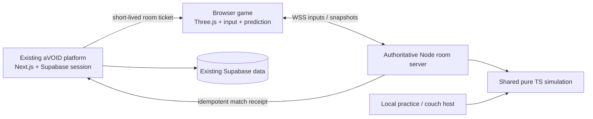

# BoomerangaVOID — product and implementation plan

Status: scoped for implementation; no game, remote repository changes, credentials, database changes or deployments were created by this planning pass. Prepared 2026-11-04 for Shane / Ideas Realized. Planning model: Astra research workers; build model requested: GPT-6.1 Sol.

## 1. The game we are making

Create an original, polished browser arena party game: tiny expressive creatures, readable toy-like arenas, a movement stick and three actions, wonderfully dangerous returning boomerangs, short rounds, satisfying saves, surprising combinations and funny non-graphic eliminations. Players should understand the basics in a minute and keep discovering skill in positioning, timing, curved throws, deflection and recall.

The working title is **BoomerangaVOID**. The creative identity is a miniature cosmic garden populated by playful stone, moss, ceramic and mechanical creatures. It belongs to aVOID, with its own characters, maps, audio, UI, effects and logo. The reference informs pace, clarity and action vocabulary, not copied expression. Do not ship Boomerang Fu screenshots, models, character likenesses, audio, map layouts, code or branding. Do not imply affiliation. A different final commercial title can be chosen later without changing the game contract.

**Release experience:** open the existing aVOID site → view the game or use its direct play link → choose Practice, Couch Party or Online Party → join/ready up → play a complete match → see results → rematch or return to the platform. Native online rooms are part of V1, not a description of screen sharing.

### V1 scope contract

| Area | Complete V1 target | Integration checkpoint |
| --- | --- | --- |
| Players | 2–6 total seats, local and remote combinations; solo practice with bots | 2 local seats and 2 separate browser clients |
| Core actions | Responsive move, dash, slash/deflect, throw, curve and recall/catch | All actions with one arena and no power-ups |
| Match flow | FFA, teams, an original relay objective; full lobby/round/match/rematch loop | FFA, first to five round wins |
| Content | 6 original silhouettes, 6 polished arenas, 8 compatible power-ups | 2 characters, 1 finished arena, 2 power-ups |
| Controls | Remappable keyboard and gamepad; shared keyboard option; usable touch controls | Keyboard and standard gamepad |
| Online | Private invitation rooms; quick join with honest empty state; region/ping display; reconnect | Private rooms on a local authoritative server |
| Identity | Google added to existing platform identity, account profile and safe room handoff | Local practice works without login |
| Presentation | Cohesive 3D diorama look, polished animation/audio, accessible HUD | Representative finished combat slice |
| Release | Existing aVOID catalog and immersive route, measured performance, deployment and rollback instructions | Local build and evidence only |

A completed checkpoint is not the finished game. Track remaining V1 work explicitly. No ranked ladder, voice/text chat, battle pass, paid boosts, custom map uploads, MMO infrastructure or full content parity with the reference is required for V1. These are deliberate scope boundaries, not unfinished core features.

## 2. Verified context and source-of-truth rules

Two related local checkouts exist. **Do not treat them as interchangeable.**

- `C:\dev\aVOID` is the registered “aVOID Games” project, remote `https://github.com/Idea-R/aVOIDhub.git`. It was on `codex/blender-rail-pilot` with many pre-existing changes, deletions and untracked game/docs assets during this audit. Root package names and README descriptions do not consistently match the working directories. Preserve everything; do not reset, clean, stage all files, or build a release from that tree accidentally.
- `C:\dev\aVOID-main` contains the modern `apps/platform` Next.js platform and its production-integration records. The live site is `https://avoidgame.io/`. This checkout is clean at `f7052f5` on `codex/fix-platform-repair-sprint-1`; it is not current main. Its [PR #61](https://github.com/Idea-R/aVOIDhub/pull/61) was verified open and unmerged through GitHub during this audit. Locally recorded `origin/main` is `0e69577`; local branch `main` is stale at `4653e58`. Neither recorded ref nor the September deployment records prove today's deployed commit.
- Both are parts of the existing **Idea-R/aVOIDhub** repository. The requested repository already exists. Keep the new game's code in this monorepo; do not create a nested `.git` directory or a redundant second remote unless a concrete later requirement justifies extraction.
- Existing platform decisions: independent game builds; platform detail route plus immersive play route; Netlify root workspace build; server-verified identity and explicit score trust; preview/rollback verification before production. Read current `DECISIONS.md`, `ROADMAP.md`, `WORKLOG.md`, `docs/V1-COMPLETION-PROGRAM.md` and the applicable `AGENTS.md` files before changing anything.
- Live platform package observed in `aVOID-main`: Next `^16.3.1`, React `^19.2.8`, Supabase JS `2.112.3`, Supabase SSR `0.12.4`, Zod `4.4.3`, Vitest `^4.1.10`. These are checkout declarations, not a dependency-health claim. Root engines require Node >=20.19 and npm >=10. Use the current compatible lockfile rather than upgrading the platform incidentally.
- RAILaVOID provides a useful simulation/presentation separation and verification-harness precedent, but its Phaser renderer and single-player dev shortcuts are not a mandate for this new 3D networked game.

Live Chrome inspection of `https://avoidgame.io/login` found **email magic links only, with no Google action**. Current platform source and locally recorded origin/main agree. Adding Google is a real platform task; remote provider configuration and an authenticated round trip remain unverified. Netlify site identity is `coruscating-squirrel-a47ad9` (site ID `780c1b04-64c7-47b6-9423-18953739590e`), with Node 22/npm 10 and the Next runtime. No persistent multiplayer host was found. See `platform-audit.md` for exact evidence and `rea-research.md` for the saved tool location.

### Repository placement decision

Keep this planning bundle under `C:\dev\aVOID\docs\boomerangavoid\` for discovery in the user-requested directory. For implementation, fetch/verify the current remote default branch and inspect existing worktrees, then use an isolated new feature worktree under the established `C:\dev\_worktrees\aVOID\` tree. Reuse a matching clean BoomerangaVOID worktree if one has appeared. Preserve the dirty legacy tree and the open PR #61 repair branch. Use a branch such as `feature/boomerangavoid` only after checking for an existing branch of that name. Do not stack on or automatically merge PR #61; integrate any necessary return-path fix deliberately and avoid duplicating another pending release. This is a base-selection gate, not a reason to rebuild the old hub.

Proposed source layout relative to the selected modern repository root:

```text
games/boomerang-avoid/                 # @avoid/boomerang-avoid, Vite + TS + Three.js
  src/{app,input,render,audio,ui,net}/
  public/{models,textures,audio}/
  verify/                             # browser journeys and evidence
  README.md, ART.md, ATTRIBUTIONS.md
packages/boomerangavoid-sim/            # pure TS rules, collision, bots, maps, replay
packages/boomerangavoid-protocol/       # versioned input/state/event schemas
apps/boomerangavoid-server/            # Node authoritative rooms; separate deploy
docs/boomerangavoid/                   # plan, decisions, work record, release evidence
assets-src/boomerangavoid/             # editable source art; exclude oversized intermediates
```

Use standard npm workspace package names, exact compatible versions in the lockfile and the repository's TypeScript conventions. Keep per-frame game state out of React state. Reuse the platform's menu/accessibility conventions, not its render loop.

## 3. Public-reference findings and REA use

The [official Boomerang Fu site](https://www.boomerangfu.com/) establishes a cute, fast local party game for up to six players, bots, team play and combinable upgrades. The [publisher's Steam listing](https://store.steampowered.com/app/965680/Boomerang_Fu/) describes one stick plus three buttons, recall, curved throws, deflection and interactive arenas. Its listed shared-screen features and Remote Play Together do not establish a native online room server. It is also available on PC, not only Switch; no purchase, download or game-binary access was undertaken here.

Everything below—exact timing, invulnerability rules, hit arbitration, camera, abilities, names and capacities—is our proposed design, not a claim to have recovered the reference's code or tuning. Validate feel by playtesting our own build. Public footage can support qualitative observation; never infer exact frame counts from an unknown frame-rate or edited clip.

Saved REA research is at `C:\dev\IdeasRealized\docs\research\technology\rea-2026-10-19`; the working Mechanics Lab is `C:\dev\IdeasRealized\Projects\REA-Mechanics-Lab`, with installed `rea-agents` 6.7.0 and upstream [morluto/rea](https://github.com/morluto/rea). A standalone clone/fork was not established. Historical experiment 002 reports the artifact-only and REA-assisted reconstructions both matching 1,008 sequences / 36,043 frames; REA added collection overhead without accuracy improvement on that small case. These records were read, not rerun.

Use REA's evidence discipline where its capabilities fit. Without a lawful local executable and an authorized task for it, binary extraction/decompilation is not part of this project. Create an observation ledger: public source URL, timestamp/scene, visible action, visible result, confidence and design consequence. Keep it separate from the implementation specification. Pair it with a reproducible input/state harness in our own game. See `rea-research.md`; no access to a reference game is needed to begin.

## 4. Rules and controls

### Camera, movement and baseline rules

Orthographic 3/4 camera, fixed arena framing that shows every active player and hazard. Logical gameplay uses a flat X/Z plane with small circles/capsules and authored obstacle shapes; cosmetic height, tumbling and debris do not affect hit detection. No free camera, platformer jumping or rigid-body character ragdolls in the authoritative simulation.

One hit eliminates by default. A shield absorbs one hit. Quick rounds target 20–60 seconds; a clear 45-second warning and closing arena after 60 seconds prevent stalemates. Default match: first to five round wins, configurable 3/5/7. Winning team shares a point; ties award none. A 3-second ready countdown, 2-second result beat and fast next-round transition keep play moving. Allow a longer readable results page at match end.

All numbers are **initial tuning hypotheses**, centralized in a versioned configuration and changed with before/after evidence:

| Parameter | Initial value | Intended feel/check |
| --- | --- | --- |
| Simulation | 60 fixed steps/sec | Same gameplay at 30, 60, 120 and 144 render FPS |
| Player radius | 0.38 world units | Visible footprint matches collision |
| Run speed | 5.2 units/sec | Cross a 20-unit arena in about four seconds |
| Acceleration/deceleration | ~45/55 units/sec² | Reach speed in ~115 ms; stop promptly |
| Dash | 2.5 units in 160 ms, 800 ms cooldown | Clear traversal commitment and recovery |
| Slash | 50 ms wind-up, 100 ms active, 200 ms recovery | Readable but immediate-feeling strike |
| Slash reach/arc | 1.2 units / 110° | Predictable visible threat wedge |
| Throw | 50 ms release, ~13 units/sec, ~7-unit outbound range | Throw reads clearly across the arena |
| Recall | Up to 16 units/sec, swept movement | Fast rescue/counterattack without teleporting hits |
| Action buffer | 80 ms | Slightly early press executes once when legal |

Initial dash is a fast dodge, **not general invulnerability**. It can cross marked small gaps while still vulnerable to weapons. Do not secretly add immunity to compensate for latency. If playtesting supports a brief evade window, add it as a documented ruleset change with explicit visuals and network tests.

### Input contract: three main action buttons

| Action | Default controller | Keyboard player 1 | Touch |
| --- | --- | --- | --- |
| Move/facing | Left stick | WASD | Left floating stick |
| Dash | South button (A/Cross) | Space | Dash button |
| Slash/deflect | West button (X/Square) | J | Slash button |
| Throw/recall | East button (B/Circle) | K | Throw/Recall button |
| Pause/settings | Start/Menu | Escape | Menu button |

Controller labels are examples of our mapping, not asserted reference bindings. Use standard browser button indices plus remapping and correct glyphs. Optional mouse aim/right-stick aim is an accessibility/advanced setting; default aim follows movement/facing so one-stick play is viable. A second keyboard seat may use arrows + numpad or remapped keys, with a rollover warning and no claim that every keyboard supports six local players. Six seats can combine local gamepads and remote clients; hardware support is measured, not assumed.

Tap throw with a held weapon to start its visible wind-up on the next simulation tick; actual release follows the proposed 50 ms wind-up. There is no charge-to-throw wait. While the boomerang is away, a fresh tap starts persistent recall until catch or a blocking collision. Releasing the button does not cancel recall; holding adds no repeated action. A blocked return becomes grounded and needs a fresh tap after repositioning. Catch never rethrows automatically: a fresh press is required. Alternate dedicated recall binding is optional without increasing the default button count.

During the first 200 ms of outbound flight, project the movement stick/vector onto the perpendicular of the original throw heading. That signed component steers the trajectory at up to 100 degrees/sec, capped at 20 degrees total bend from launch heading; a neutral stick adds no bend. The same input continues normal player movement. This is the default one-stick/keyboard curve rule; optional separate aim affects launch direction, not the steering limits. Start with these readable limits, then tune from play evidence. Include a short target exercise that teaches moving sideways after a throw.

Twin Arc is a paired volley, not an ambiguous extra throw button: when both slots are held, one fresh throw releases both in a symmetric narrow fan. If either is away, the button recalls every non-held slot; a caught slot waits until both are held before the next volley. Dead/blocked cleanup applies per weapon, and no slot can multiply beyond the two-weapon cap. The first slice does not need Twin Arc, but its input contract is fixed before adding the upgrade.

Pause stops local simulation only. In online play it opens settings while the room continues, sends neutral movement, and clearly states that play continues. Blur/controller unplug resets stuck inputs. Rejoin requires deliberate input before control resumes. Web Audio starts after the player's first gesture.

### Weapon and combat contract

State machine: `held → outbound → returning → held`; collision can produce `grounded`; recall transitions `grounded → returning`. Every weapon has a unique ID, owner seat, generation counter and lifecycle timestamps. The baseline has one boomerang per player. Without it, slash becomes a short shove that interrupts movement but cannot kill, making recall meaningful.

- Outbound flight uses an authored curved trajectory with swept circle collision; it cannot tunnel through thin walls at low render FPS. Range expiry starts return. Hard wall contact grounds it; one named upgrade may enable a bounded ricochet.
- Normal return travels toward its moving owner but still collides with cover. A blocked recall remains visibly grounded and can be retried after repositioning. If stuck for 3 seconds, a visible 1-second safe rematerialization returns it to the owner **without damage**. A dead owner's weapon becomes inert and is cleared at round transition.
- Returning weapons can hit opponents. Their return owner catches them; friendly-fire setting controls team damage. An ordinary unreflected weapon cannot harm its own seat; the deflected-outbound exception is defined below.
- A well-timed armed slash deflects an incoming weapon, changes its flight heading, and sets its damage attacker/team to the deflecting seat for that flight segment while retaining a separate return-owner ID. During deflected outbound travel the original owner can be hit; owner catch/safety resumes only in the returning phase. The deflector cannot damage their own seat, and friendly-fire uses the current attacker's team. Clear colour and sound show the change. Both weapons in a head-on clash ground rather than disappear.
- Hazards, shields, attacks and death are resolved once per simulation tick with deterministic event IDs. Use the arbitration sequence below; emit one death and at most one kill credit per eliminated seat. Shield grace starts at 100 ms (six simulation ticks), absorbing all coincident contacts as one charge.
- Dead seats have no collision, input or damaging weapon. Death animation, sound and points are emitted once. Disconnects and reconnections never resurrect a seat mid-round.

Keep all gameplay clocks, cooldowns, spawn schedules, bot decisions and randomness inside simulation state. Decorative randomness and animation can be client-local. A fixed tick alone does not prove cross-platform determinism: retain replay hashes across supported runtimes and reconcile online clients to server state.

Combat arbitration contract: advance scheduled state transitions and accepted inputs at tick start, then sweep movement/attacks to find contacts in increasing time of impact. Treat contacts within 0.0001 of the normalized tick as one simultaneous group. For each group, resolve terrain/projectile clashes first, then valid slash deflections, then shield/grace defenses, then batch the remaining damage to currently living seats. Batch damage permits reciprocal kills within that group. Emit eliminations and invalidate those seats' future damaging contacts/weapons before processing a later group. A weapon deflected or grounded in a group cannot also apply its obsolete pre-contact path in that group; recompute its remainder. Stable entity IDs resolve shared pickups and bookkeeping only; they must not give one player arbitrary immunity from a simultaneous trade. If several attackers jointly eliminate a seat at the same instant, use the earliest contact then stable attack ID as the single credited attacker, while preserving assist IDs in match evidence. All threshold values belong to the ruleset hash.

## 5. Original content and presentation

### Identity and art pipeline

Art target: warmly lit miniature gardens on floating stone platforms, softened edges, strong shape language, rich but controlled colour, clean character silhouettes and tactile props. Use three-dimensional stylized models with baked colour/ambient shading, simple materials, contact/blob shadows and a single restrained lighting setup. Optional higher-quality effects must degrade gracefully. Keep threat colours distinct from decoration. No real-time global illumination requirement or expensive postprocessing stack.

Six working character concepts with identical gameplay stats: **Pip** (moss pebble), **Kiln** (small ceramic guardian), **Volt** (wind-up firefly), **Nori** (folded leaf creature), **Cairn** (stacked stones), **Comet** (soft starseed). Shapes differ enough to identify in grayscale; player colour is trim plus a shape marker. Names and final artwork are original working concepts, to be checked against the game's own catalog before shipping.

Create editable Blender sources and GLB exports with consistent scale, pivots, simple rigs and named animation clips. Deliver idle, run, stop/turn, dash, slash, throw, recall strain, catch, hit, elimination, victory and spawn. Prefer a small high-quality reusable rig family over six unfinished rigs. Use the available Blender/asset skill when doing that work, and inspect exports in the actual game camera before multiplying assets.

Non-graphic elimination families: ceramic break into 6–10 chunky pieces, spring-pop into harmless parts, moss poof with tumbling pebbles, flattened squash then a floating spark, icy brittle pop for the cold effect. No procedural gore. Debris lasts <1.5 seconds and never masks a projectile or becomes an authoritative physics object. Pool meshes and particles; reduce debris automatically under low quality.

Feel layer: 30–50 ms local hit accent, brief camera impulse, 80–140 ms trails, grounded dust, readable slash arc and a distinct returning-weapon sound. Online simulation never pauses for hit-stop; freeze/scale only presentation, with a reduced-motion alternative. Respect mute, music/SFX controls, vibration toggle, flashing limits and reduced motion. Subtle haptics are optional and must fail silently on unsupported pads.

Starting asset budgets (to validate on target hardware): <12 MB compressed initial playable download, later arenas preloaded behind the round-readiness barrier; <100k visible triangles and <120 draw calls for six-player combat; <=1024² atlases unless demonstrated need; no unbounded particles or texture allocations. Keep source attribution/license metadata for every external dependency and asset. Generated artwork is not proof of runtime quality; inspect animation and silhouettes in motion.

### Six arenas

| Arena | Tactical purpose | Distinctive feature |
| --- | --- | --- |
| Moss Court | Learn throw/recall/cover | Four rounded cover islands, open return lanes |
| Kiln Courtyard | Time movement | Telegraphing pressure vents, safe perimeter |
| Tideglass Steps | Commit to routes | Small dash gaps and moving bridge segments |
| Windbell Garden | Read projectile path | Visible wind lanes affect weapons, not players |
| Moonwell | Manage angles | Two paired gates rotate a weapon's exit heading |
| Lantern Foundry | Final chaotic showpiece | Slow conveyor rings and clearly warned shutters |

Each map is authored data with spawn positions, safe ground, obstacles, hazards, traversal edges and bot navigation. Validate no overlapping spawns, no unreachable return routes, no unavoidable spawn deaths, no player hidden by foreground props and no map dominated by one stationary angle. Test every map without power-ups before adding combinations. Two original mechanics—the Moonwell directional gates and Windbell lanes—provide identity without adding new control buttons.

### Power-ups and modes

V1 upgrades: Guard Shell (one-hit protection), Twin Arc (second weapon with explicit resource slots), Skipstone (one wall ricochet), Tailwind (faster return), Frost Wake (temporary slowing trail), Ember Fuse (delayed area burst with visible countdown), Echo Step (harmless dash decoy), Magnet Bloom (small recall pickup radius). Names/art are original. Allow at most two passive upgrades plus one consumable shield initially; compatible combinations are specified in data, with caps on spawned weapons/effects. Incompatible pickups offer a clear replacement instead of silent loss. No nested proc loops: spawned effects carry origin IDs and cannot recursively trigger their parent effect. Rebalance from measured matches, not assumed reference values.

FFA and 2v2/3v3 teams use the same core rules. **Relay Seed**, our objective mode, uses two teams and a separate five-minute match clock, first to three deliveries. The server seeds a shared alternating zone sequence A→B→A; the first target is visibly announced before play. One neutral seed starts at center. A living seat can pick it up on contact; earliest swept contact wins, stable seat ID breaks an exactly tied pickup. The carrier must remain in the active target circle for an uninterrupted 500 ms to score; opposing presence pauses progress, and leaving resets it. Score returns the seed to center after a two-second lockout and advances the target. A tied timer ends in sudden death, next delivery wins.

Carrying always converts attack to shove and disables throw so the courier has a readable vulnerability, even if holding a weapon. Picking up the seed cancels that seat's flying weapons into a harmless return; no in-flight damage survives pickup. A successful enemy hit drops the seed with a 500 ms no-repickup lockout for the former carrier. Shield absorption still drops it but leaves the carrier alive. An unshielded hit eliminates; objective-mode seats respawn after three seconds at a safe validated spawn with one second of visible protection. Protection ends after that second or on deliberate attack; a protected seat cannot pick up the seed. Disconnect drops the seed immediately. The normal FFA/teams mode remains one-life rounds; Relay Seed deliberately uses respawns. These choices are our original rules, not recovered reference behavior.

Implement FFA first; mode-specific rules stay isolated. Configurable bots fill local practice and private rooms only when players explicitly enable them. Never present a bot as a human quick-join opponent.

Bots use perception and reaction delays, steering/navigation, cover/recall decisions and short projectile threat prediction. Easy/normal/hard share legal inputs and cooldowns. They do not read future inputs, teleport weapons or use immunity. Seed bot randomness; support reproducible six-seat soak matches.

## 6. Architecture and genuine online multiplayer

**Recommended stack:** TypeScript + Vite + Three.js WebGL2 client; pure TypeScript kinematic simulation; Node.js + Colyseus authoritative room service; the existing Next.js/Supabase platform for identity, catalog and persistence. Three.js supplies rendering, not combat/physics authority. Keep existing games and their engines intact. Verify exact current Colyseus/client/schema compatibility with a two-client spike before pinning versions; its [0.18 netcode documentation](https://docs.colyseus.io/netcode) now includes prediction/reconciliation support.



Netlify continues serving the platform and game files. A stateful match service needs a separate persistent runtime. Netlify's own [platform comparison](https://www.netlify.com/knowledge-base/netlify-vs-render/) distinguishes static/serverless frontend hosting from persistent WebSocket services. **Do not implement combat authority through database updates, Supabase presence, a Netlify request loop or a privileged browser host.** Supabase may store completed results and profiles; it is not the per-frame game transport.

### Room/service contract

- 60 Hz authoritative step, 20–30 Hz snapshots/patches initially, client interpolation around 75–100 ms; measure and adjust. Cap catch-up work; never amplify a stalled loop indefinitely. A server overload causes a recorded degraded state or orderly room stop, not changed game speed.
- States: `lobby → loading → countdown → playing → roundResults → loading ... → matchResults → lobby`. Before each countdown, server sends map/content/rules hashes and participating seats. Every client acknowledges that exact content as ready. A failed/mismatched asset gets one retry, then the client can spectate or leave; no invisible player enters active combat. After a 20-second loading timeout, move unready seats to spectators and start only if mode minimums remain valid. Otherwise return to lobby with a clear explanation. The host cannot override readiness. Reconnect during loading repeats the hash handshake.
- Ready/character/team inputs are server-validated. Join in progress spectates until next round (Relay Seed joins at the next safe respawn window after readiness). Lobby owner controls settings but has no simulation authority; transfer owner role on departure.
- Rooms are private by default. Quick Join finds only hosts' explicitly public, waiting lobbies of the same protocol, mode, region and adequate seat capacity. Reserve the requested seat group atomically with a short expiry; never split a local party across rooms. No suitable room shows “No open rooms” with Create room and Practice actions, rather than disguising bots as opponents. Ready countdown requires at least two opposing occupied seats/teams as appropriate. Invitation codes are unguessable identifiers plus rate-limited lookup, not authentication credentials.
- Up to six player seats per room and bounded spectators (initial cap four). Each connection may control explicit local seats. Server binds each seat to the authenticated session; local guests appear as `DisplayName · Guest 2`, receive no separate account rewards and cannot impersonate another account.
- Client sends only bounded normalized movement, facing, button edges/holds, sequence, client tick and owned seat ID. Server rejects malformed, duplicate, out-of-window, oversized and excessive messages; clamps input rate and validates ownership. Never accept position, damage, scores, cooldowns, team privileges or RNG from the client.
- Use server-issued tick/round identity and ping-based offset estimation. Client ticks are hints, never permission to rewind or fast-forward. Initially accept mapped ticks no more than six ticks ahead and 15 ticks behind; future input queues only until its valid tick, recent late input applies at the next legal tick, older input is discarded. Queue at most 12 commands per seat; consume at most one normalized input state per seat per server tick, with monotonic sequence and once-only action edges. A burst of delayed TCP frames cannot grant several attacks or extra movement in one tick. Exact windows can be tuned and versioned after latency testing.
- Expire movement/held input after 150 ms without a newly accepted command, independent of socket connectivity and the reconnect lease. Background/frozen tabs therefore stop rather than drift indefinitely. Round transitions clear queued actions and require the new round ID. Multi-seat packets validate each owned seat, and one connection's packet rate cannot grant each seat unlimited commands.
- Predict local movement and immediate animation; reconcile to acknowledged inputs. Remote entities interpolate; projectiles can extrapolate briefly within bounds, then wait/correct. Kills, shields and points are authoritative. Keep recent stable event IDs so effects do not duplicate during reconciliation.
- Baseline hit resolution uses server-time continuous collision; do not initially rewind every projectile against old player positions. At 120 ms RTT, measure fairness, deflections and correction frequency. If a bounded lag-compensation scheme is needed, document a maximum rewind (e.g. <=100 ms), include dynamic cover and test abuse. Never trust a client timestamp to determine a hit.
- Heartbeats and a 20-second reconnect seat lease. On disconnect, clear input and preserve the existing living entity without immunity; do not grant a free escape. After lease expiry, remove the seat between rounds. On reconnect, restore the same seat and authoritative state. Page refresh needs a recoverable session handle; tokens stay out of URLs/logs. Server restarts end affected matches gracefully in V1 rather than pretending seamless migration exists.
- Match manifest contains protocol/rules version, content hash, seed, player/seat IDs and mode. Refuse incompatible clients with a refresh action. Drain existing matches during deploy; new clients connect only to compatible versions.
- Online completion receipt is server-originated, idempotent by match ID and independently validated by the platform. Never expose the service credential to the browser. No new globally ranked board at launch; show personal/party results and clearly label local-only outcomes. Add competitive ranking only after rules/version integrity and abuse testing are complete.

### Hosting plan and decisions still needed

Start the room server locally and package it with health/readiness endpoints, Dockerfile, graceful termination, metrics and an environment template. Discover whether an existing authorized persistent runtime is available. If none exists, prepare a concrete candidate deployment on a Node/Docker host such as Render or Colyseus Cloud, including the exact plan, region, expected monthly cost, limits, secrets required and rollback. Do not create an account, new credentials or a billable service during the planning pass.

Proposed later endpoint: `wss://realtime.avoidgame.io` (a design proposal, **not an existing domain/configuration**). Use an existing approved hostname instead when discovered. Validate CORS/origin allowlists, TLS, handshake ticket expiry, reverse proxy timeouts and health checks on the chosen host. Start one region near the expected first audience, show ping and recommend private rooms when latency is high. Multi-region routing and Redis/distributed matchmaking are later capacity work, not required for the first six-player room.

Initial capacity gate: 20 concurrent full rooms / 120 player seats for 30 minutes on the selected candidate instance, plus a two-hour six-seat soak. Measure tick p95, CPU, RSS, bandwidth, disconnects and event-loop lag. This is a target experiment, not a capacity claim. Bound active rooms and admission; queue/return a clear busy state instead of exhausting the process.

## 7. Authentication and platform integration

Reuse modern platform identity and its same-origin cookie/session contract. Add the Google action to `apps/platform/src/components/AuthForm.tsx` using the existing SSR browser client; retain email login and reuse `src/app/auth/callback/route.ts`. Read `apps/platform/AGENTS.md` and the relevant installed Next docs before writing code. Do not copy the legacy game-hub's browser-token bridge merely because it contains a Google button. The existence of provider code, an environment variable or HTTP 200 does not prove a successful Google login.

Required journey: `/games/boomerangavoid/` → `/boomerangavoid/` → Online → existing `/login/?next=<validated local destination>` → Google → platform callback → return to the correct lobby/route. Preserve an invitation in server/session state or a validated local path, without attaching bearer tokens to links. Local practice and couch mode must remain available if Google or the network is unavailable.

Use minimal Google identity scopes. Do not request Drive, Gmail, contacts or offline provider access. With the platform's SSR flow, the callback must exchange the code and persist the session correctly. Google Cloud's authorized callback is the Supabase auth callback; Supabase's allowed redirect is the app callback. These are different URLs. Review the existing client/provider rather than creating a second OAuth application. [Supabase's Google guide](https://supabase.com/docs/guides/auth/social-sign-in/auth-google) and [redirect guide](https://supabase.com/docs/guides/auth/redirect-urls) describe the distinction.

For a game-server handshake, prefer a short-lived single-use ticket minted by a same-origin platform POST after checking the existing session. The room server redeems it through a trusted server-to-server boundary or verifies an existing supported signing mechanism. Ticket binds user ID, allowed seats, room/audience, expiry and nonce; it does not grant broad platform privileges. Choose reuse of existing server credentials only after reviewing scope. Any new secret or persistent access is a separately reviewable step.

Persist only account identity/cosmetic preferences and verified server match summaries required by the UI. Draft migrations may add scoped `boomerang_matches` / seat-result tables or extend existing game-result schema after an audit. Apply RLS: users read permitted own records; only trusted server finish operations write verified results; clients cannot award wins. No application of migrations in this planning pass.

Platform integration files to inspect/change in the selected tree include game catalog/data definitions, game-detail metadata/controls, `apps/platform/scripts/prepare-games.mjs`, root `build:platform:games`, route rewrites, tests and sitemap. Add one isolated artifact copy target with path validation. Proposed game build output: `dist/BoomerangaVOID`; serve at the lowercase immersive route without breaking existing mixed-case legacy redirects. Keep the catalog label “In development” until the complete release gate passes; never add a dead Play link.

## 8. Quality, completion and evidence

The detailed gate list is in `VALIDATION-MATRIX.md`. Evidence must come from the actual implementation and be committed or linked from the work record. This planning pass does not claim any of these game tests passed.

**Development interface:** expose read-only `window.__BOOMERANGAVOID__` version/readiness/state summary/performance in debug builds. Test-only fixtures may set seed/start scene/step local simulation only in isolated test builds. The production room server must reject fixture/admin messages. Real input journeys must test the transitions; a force-win function is not a match test.

**Performance targets:** desktop 1080p targets a sustained 60 FPS cadence, median frame interval around 16.7 ms and p95 <=20 ms over a two-minute six-seat route; mobile low quality targets sustained 30 FPS, median around 33.3 ms and p95 <=40 ms on named real hardware. Record delivered frames, missed-frame fraction and long-frame distribution separately; p95 alone does not prove average frame rate. Target no 100+ ms steady-play stalls and first playable <=5 seconds after cached app load on a specified broadband profile. Measure loading separately. Do not report headless/SwiftShader performance as physical-GPU evidence. Browser/hardware matrix: current Chrome/Edge and Firefox desktop, Safari on macOS/iOS, Chrome on a representative Android device; unsupported combinations get accurate wording and a local fallback when feasible.

Authority, original assets, preservation of existing work, true online play and honest evidence are hard requirements. Timing/feel values, interpolation, capacity, asset and performance budgets are initial measurable targets. Revise them only through a recorded experiment explaining hardware/context, player impact and the new acceptance limit; do not silently lower a failing target to report a pass. M1 feel and M2 impaired-network acceptance must pass before expanding all content. The complete content target is substantial; estimates below carry uncertainty, especially for original animation, mobile input and real service QA.

**Experience acceptance:** first-time player completes move/dash/slash/throw/recall tutorial without developer help; character and weapon remain readable at gameplay scale; every death clearly communicates cause; rematch takes one action; a complete six-seat match can finish without console errors or stuck state; two geographically separated clients complete a match and reconnect. Touch emulation is not proof of a phone's performance or gamepad support.

**Release acceptance:** all gameplay gates, input tests, visual captures, networking impairment tests, platform regression tests, auth canary, dependency/asset-license check, server capacity run and reversible preview verification complete. A signed-in existing user plus an allowed new-user flow must prove Google return, session refresh, logout and re-login. If account interaction requires Shane, report that exact final canary; do all other work first. Do not mark login “working” from code inspection.

## 9. Milestones and staffing

Model workflow: Astra owns this scope/architecture; GPT-6.1 Sol becomes implementation lead. Bounded workers may handle simulation/network, art/animation, platform/auth or independent QA with explicit file ownership. One integration lead owns shared types, lockfile, root scripts and merge decisions. Do not have multiple agents edit the same package/registry simultaneously. No runtime LLM is required.

Estimates below are effort bands in focused engineering/production days with review, not promises of autonomous wall-clock delivery. Generative tooling can shorten implementation, while playtesting, account access, art iteration and hosting evidence remain real gates. A credible complete V1 is roughly 30–50 focused workdays; the first playable is much smaller.

| Milestone | Work and exit evidence | Effort band |
| --- | --- | --- |
| M0 — establish base | Verify production lineage, worktree ownership, REA notes; pin minimal tools; runnable client/sim/server skeleton; decide hosting candidate without provisioning | 1–2 days |
| M1 — combat slice | One polished arena, two characters, all core actions, local two-seat play, input/state tests, first recorded match | 4–6 days |
| M2 — true online | Two to six clients, room state, prediction, input validation, reconnect, impaired-network evidence; no trust in browser scores | 5–8 days |
| M3 — complete party loop | Bots, teams/relay, six-seat local/remote mix, lobby/invite/tutorial/settings/results, complete match/replay tests | 4–6 days |
| M4 — content and feel | Six characters, six arenas, eight upgrades, animation/audio polish, readable combinations, accessibility and mobile pass | 7–11 days |
| M5 — platform and identity | Modern catalog/build integration, real Google flow, safe room tickets, profile preferences and server receipts, isolated data tests | 3–5 days |
| M6 — release candidate | Load/soak/device QA, regression repair, hosted preview after authorization, operational runbook and rollback, final evidence review | 6–10 days |

Art prototyping can overlap M1/M2; final content expands only after M1 feel and M2 authority contracts hold. Platform/auth inspection starts at M0 so access problems are known early. Do not defer all networking until after making the whole game.

### Next implementation session

Start with `SOL-IMPLEMENTATION-HANDOFF.md`. Resolve the current platform base, create the four new workspaces and a one-arena combat slice with the same simulation runnable locally and on a local server. Produce a short captured real-input match and evidence JSON before expanding content. Update a durable `WORKLOG.md` and `BACKLOG.md` with current commit, commands, done/next, decisions and blockers at each checkpoint. Continue through the authorized scope; a checkpoint is not a reason to claim completion.

## 10. Release constraints and open decisions

| Item | Current status | Concrete resolution |
| --- | --- | --- |
| Correct production base | Modern checkout found; local records can be stale | Compare worktrees, current remote main and live deploy identity before code integration |
| Existing local changes | Many in the registered aVOID checkout | Preserve; stage only owned paths; select a clean/available current base |
| Google sign-in | Live and current source are email-only; remote Google settings unknown | Add current-platform Google OAuth; inspect existing provider setup, then test callback/session/return end-to-end |
| Persistent multiplayer host | No service provisioned by this task | Discover existing authorized runtime; otherwise present exact host/region/cost/config plan |
| Credentials/access | No creation or expansion authorized in this planning pass | Reuse only verified scoped existing access; obtain explicit approval for any genuinely new persistent credential |
| Preview/production publication | Not performed | Finish concrete candidate and evidence first; follow existing approval requirements before publishing |
| Real devices/remote players | Not exercised in planning | Measure on named available devices; record any unavailable hardware as an explicit release limitation |
| Asset rights/quality | New asset pipeline planned | Original editable sources, attribution manifest and in-game inspection before release |

This bundle makes the next build actionable without asking Shane to re-specify the game or assemble a prompt. Remaining tuning and implementation decisions can be resolved through the specified experiments; remote access, real-device evidence and release authorization remain explicit gates.
